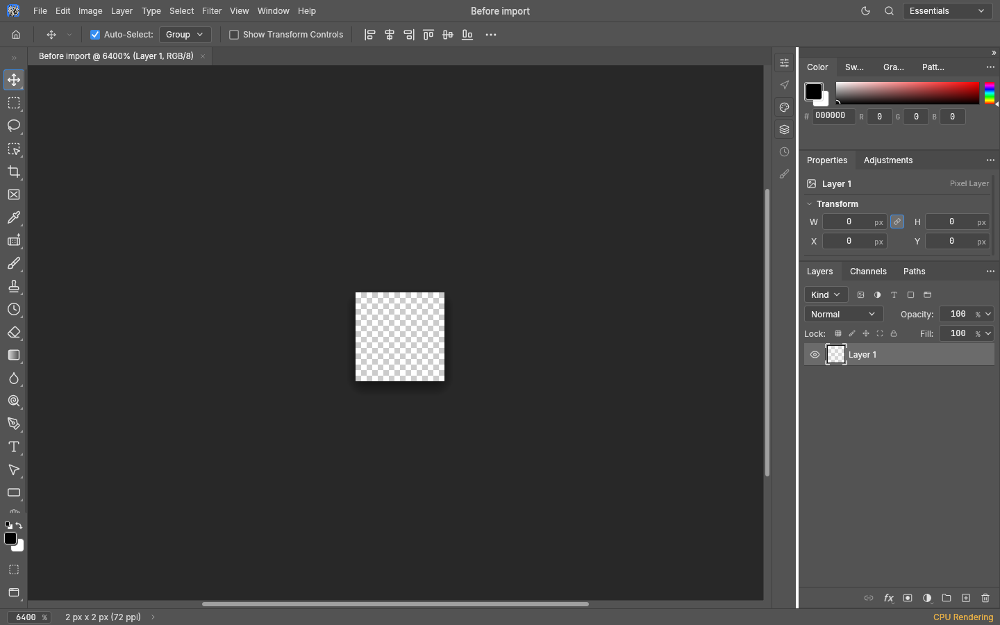
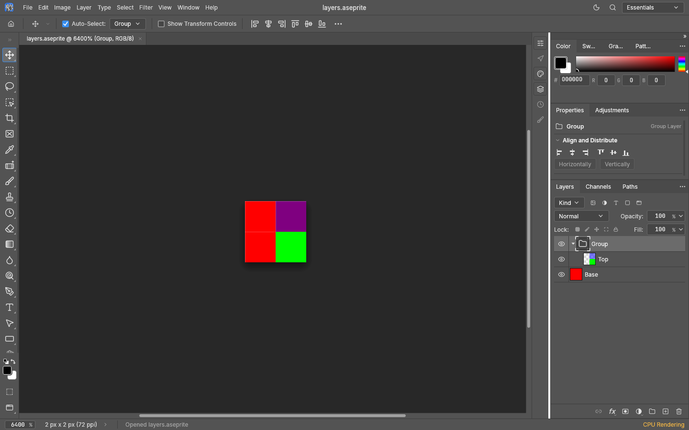

# Aseprite import

PhotoCraft opens supported **single-frame** `.aseprite` and `.ase` documents as editable
raster layers and groups (part of [#3811](https://github.com/storytold/photocraft/issues/3811)).
Use File › Open, drag the file onto PhotoCraft, or use the existing CLI, engine and control
open methods. Folder batches discover `.aseprite` and default its output to PSD; the ambiguous
`.ase` extension is accepted explicitly by Open/CLI but is not scanned as a batch image.
The desktop picker includes Aseprite; the browser picker accepts `.aseprite`.

RGBA (32 bits per pixel) and grayscale-with-alpha (16 bits per pixel) both contain 8-bit
samples. Raw and zlib-compressed cels retain their samples, alpha and offsets, including
pixels outside the canvas. Layer names, bottom-to-top order, nested groups, visibility,
opacity, locks and collapsed state are imported. A single cel's opacity is multiplied into layer
Opacity, retaining the combined appearance without changing stored pixel samples. The 19 documented blend IDs map to PhotoCraft's
corresponding modes; exact Aseprite blend rounding has not been established for every mode.
Groups follow the header's isolated/pass-through compositing policy.

An Aseprite document is **import-only**: Save asks for another format. Save As `.pcraft` or
PSD retains the supported editable structure; PhotoCraft does not write `.aseprite` files.
The original source is never adopted as a writable save path, even when renamed.

`.ase` also names Adobe Swatch Exchange files. Aseprite's binary signature routes sprites to
document import, while an Adobe `ASEF` swatch file continues to load into Swatches. An extension
alone never turns a swatch file into a sprite.

## Current limits

Animation, indexed color, linked cels, tilemaps/tilesets, reference layers, precise/scaled cels,
per-cel z-order and non-square pixels are refused with an error. Export a supported still
RGB/grayscale copy from Aseprite first. This initial importer does not close the comprehensive
bidirectional-support request.

Embedded RGB/gray ICC profiles and sRGB/linear-sRGB profiles are retained or generated in the
appropriate color model. Other fixed-gamma profiles are refused. Untagged files stay untagged.
Palettes, tags, user data, slices, saved masks, UUIDs and external-reference metadata are not
retained; the import reports these omissions. External files are never read. Unknown chunk
types are refused because they may change rendering. Canvas grid settings and the single
frame's playback duration are not imported.

Files are capped at 512 MiB, layer/group count at 4,096, chunks at 65,536, group depth at the
document model's limit, and decoded layer tiles at 256 MiB across the whole document. The
tile budget includes partially occupied boundary tiles and off-canvas pixels. Compressed
pixels are inflated one row at a time, with exact-size and checksum checks and cooperative
cancellation; a huge declared cel cannot allocate a huge full-image buffer.

## Implementation and evidence

The reader in `crates/io/src/aseprite.rs` follows the
[public binary specification](https://github.com/aseprite/aseprite/blob/main/docs/ase-file-specs.md).
No Aseprite application source, assets or runtime dependency is used. The independent
`aseprite-io` crate was evaluated; its current parser lacks the resource and chunk bounds this
import requires, so this narrow reader reuses PhotoCraft's existing zlib dependency.

The original tiny fixture under `crates/io/tests/fixtures/aseprite/` has hand-computable pixels
and an independently checked layer tree. Tests cover raw/compressed RGB/gray, offsets, opacity,
groups and header flags, profiles, native/PSD round trips, malformed records, decompression
limits, cancellation and mutations. UI tests cover `.ase` disambiguation and read-only Save
behavior; CLI tests cover inspection and conversion. Synthetic evidence does not establish
compatibility with every real Aseprite document.

## Visual check

These are workflow captures from this implementation: a blank 2 × 2 document before opening
anything, then the imported synthetic fixture at the same zoom. The first is not a render of
an older PhotoCraft version. The second shows the four expected colors and the editable
Group / Top / Base tree. Captured offscreen with the CPU canvas at 6400% zoom.

